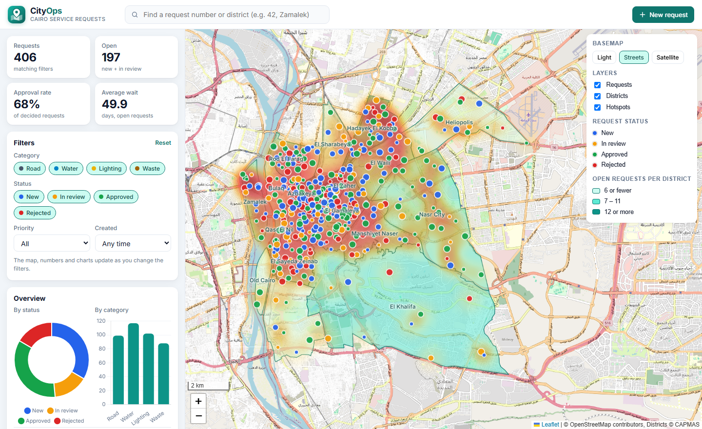
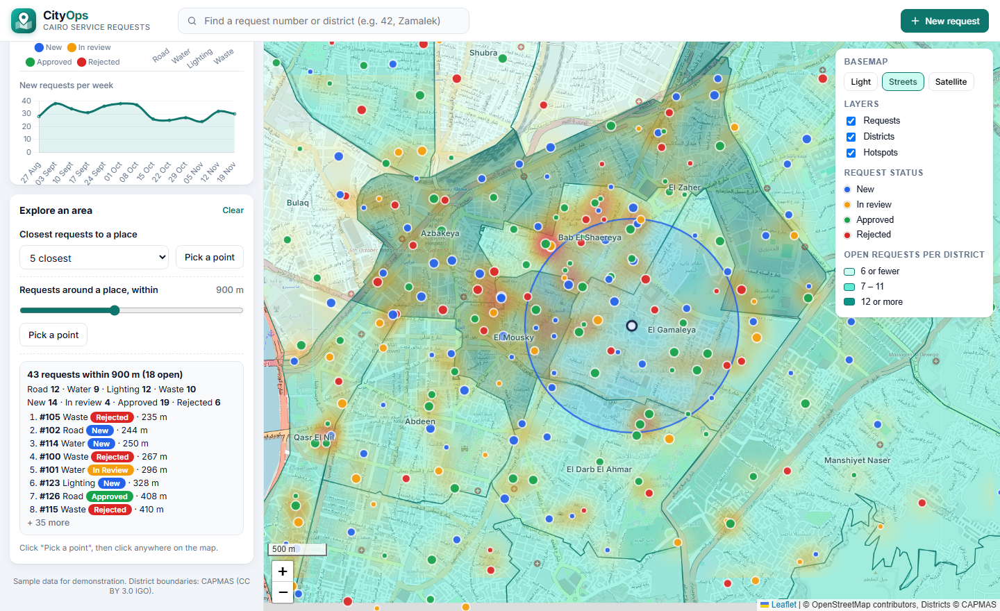

# CityOps: web GIS dashboard on PostGIS + GeoServer

A production-shaped web GIS application for city service requests (roads, water, lighting, waste) across
21 real districts of central Cairo.
It reads, analyses and **edits** spatial data through standard OGC services, and the whole stack,
including all GeoServer configuration, comes up with one command.

**Live demo:** https://poulamories-cityops.static.hf.space (the browser-only version described under
[Static online demo](#static-online-demo-free-static-hosting); the full stack runs locally with Docker).





## Features

- **Live KPIs and charts**: request count, open requests, approval rate and average open age; charts by status,
  category and week (Chart.js).
- **Server-side filters**: category, status, priority and date filters are sent to GeoServer as ECQL and
  executed by PostGIS.
- **Real district boundaries**: 21 Cairo districts (Zamalek, Qasr El Nil, Heliopolis, Nasr City and more) with
  English and Arabic names; each request shows the district it falls in.
- **Map layers**: district choropleth rendered by GeoServer **WMS** with an SLD style, request points from
  **WFS** (GeoJSON), heatmap, and Light / Streets / Satellite basemaps.
- **Spatial analysis**: *nearest N requests* (KNN `<->`) and *requests within a radius* (`ST_DWithin` on
  geography), published as **parameterised GeoServer SQL views** with regex-validated parameters. They
  apply the dashboard's filters inside the query (before `LIMIT`), so they count the same requests as the map.
- **Edit on the map (WFS-T)**: add a request by clicking the map, change status or priority, or delete it.
  Edits are saved to PostGIS through **WFS-T Insert / Update / Delete**.
- **Search**: jump to a request number or a district.
- **Always up to date**: every add, change or delete refreshes the KPIs, charts, district counts and colours, and the
  open area search; a background check every 15 s (paused while a form or popup is open) picks up other users' edits.

## Architecture

```
Browser (Leaflet + Chart.js)
   │  http://localhost:8088
   ▼
Nginx ── /geoserver/*  (read: WMS, WFS, SQL views) ─────────────┐
   └──── /api/wfst     (POST only, Nginx adds editor credentials) ┤
                                                                  ▼
                                              GeoServer ──JDBC──► PostGIS
                                                  ▲
                              publish.sh ──REST───┘  workspace, store, SLD styles,
                                                     layers, SQL views, security
```

## Run it

```bash
cp .env.example .env          # change the passwords
docker compose up -d
docker compose logs -f publish   # wait for "Done"
```

Open **http://localhost:8088**. GeoServer admin is at http://localhost:8088/geoserver (credentials from `.env`).
Add `?demo=analysis` to the URL to open the dashboard with the radius tool and heatmap already shown.

## Static online demo (free static hosting)

`static/` builds a server-free version for static hosts (Hugging Face Static Spaces, GitHub Pages, Netlify):
the same `app.js` switches to `static/static-api.js`, which answers the data calls in the browser from
sample data exported from PostGIS (`static/data/*.json`). District counts, filters and the closest/radius
searches follow the same rules as the SQL; a visitor's edits are kept in their own browser, with a
"reset sample data" link. Dates move forward with time, so the "last N days" filters keep working.

```bash
python static/build.py static/dist     # then upload the contents of static/dist
```

## Deploy publicly (e.g. Oracle Cloud Always Free)

`deploy/` packs PostGIS, GeoServer and Nginx into one container built on plain Ubuntu, so it runs on
Intel/AMD and on ARM servers such as Oracle Cloud's free Ampere machines (it needs about 1.2 GB of memory).
Caddy sits in front and serves HTTPS with a free Let's Encrypt certificate.

- random passwords at every start; only the public map services are exposed (no GeoServer admin or REST)
- visitors can add, edit and delete; the sample data is restored nightly at 03:00 UTC and on every restart
- the first edit is warmed up during start-up, so it is fast for the first visitor

```bash
# on a fresh Ubuntu server, from the geo-stack folder (allow TCP 80/443 in the cloud firewall first):
bash deploy/server-setup.sh <public-ip>     # -> https://cityops.<ip-with-dashes>.sslip.io
```

Test the same image locally: `docker build -f deploy/Dockerfile -t cityops . && docker run --rm -p 7860:7860 cityops`.

## Engineering details

| Area | Detail |
|---|---|
| Data model | `districts` multipolygons (English and Arabic names) and `service_requests` points with GiST indexes and CHECK constraints |
| Spatial SQL | `district_stats` view counts open and approved requests per district with `ST_Contains`, live after every edit |
| WFS-T and defaults | GeoServer sends `NULL` or `''` for attributes the client omits (and 1970-01-01 for an omitted timestamp), so column defaults never fire; a trigger applies them and stamps `updated_at` |
| Security | Reads are public; writes need `ROLE_EDITOR` (GeoServer data rules set over REST). Nginx injects the editor's Basic auth on `/api/wfst` only, so no password reaches the browser |
| GeoServer automation | `geoserver/publish.sh` creates everything through the REST API and is safe to re-run; style edits are pushed with `PUT` |
| SQL views | `nearest_requests` and `requests_within_radius` take `lon`, `lat`, `k` / `radius` plus the filters (`cats`, `sts`, `prio`, `days`) via `viewparams`, each checked by a regex validator |
| Front end | Plain JS, no build step: Leaflet, Leaflet.heat and Chart.js from cdnjs; responsive layout with a collapsible panel on mobile; plain-language UI with no technical terms shown to end users |

## Tested

Nearest and radius queries · parameter validation · filter combinations · WFS-T insert, update and delete through
the UI (including HTML and quote characters in descriptions) · anonymous WFS-T blocked · `GET /api/wfst` refused ·
no browser console errors.

## Files

```
docker-compose.yml               PostGIS, GeoServer, publish job, Nginx
db/init/01_schema_and_data.sql   schema, trigger, sample data, stats view
geoserver/publish.sh             REST automation (layers, styles, views, security)
geoserver/styles/*.sld           request status and district choropleth styles
geoserver/views/*.xml            parameterised SQL views
web/site/                        index.html, app.css, app.js
web/nginx.conf, 40-editor-auth.sh   reverse proxy + server-side WFS-T auth
static/                          browser-only demo: static-api.js, exported data, build.py
deploy/                          single-container image (Intel/ARM), Caddy HTTPS, server setup script
```

After editing an SLD, run `docker compose run --rm publish` to push the change.

## Data

- District boundaries: CAPMAS / OCHA ROMENA, published through [geoBoundaries](https://www.geoboundaries.org/)
  (gbOpen EGY ADM2), licensed CC BY 3.0 IGO. Simplified to about 15 m for the web.
- The source boundaries sit about 120 m east of OpenStreetMap. A fitted shift (120 m west, 28 m south),
  checked against OSM's Zamalek and Roda islands and Heliopolis, raises their overlap from 0.63–0.91 to
  0.95, so districts line up with the streets and the Nile on the basemap.
- Service requests are synthetic sample data, generated with fixed seeds inside each district.
- Basemaps: OpenStreetMap contributors and Esri World Imagery.

## Reset

```bash
docker compose down -v   # removes the database and GeoServer data volumes
```
